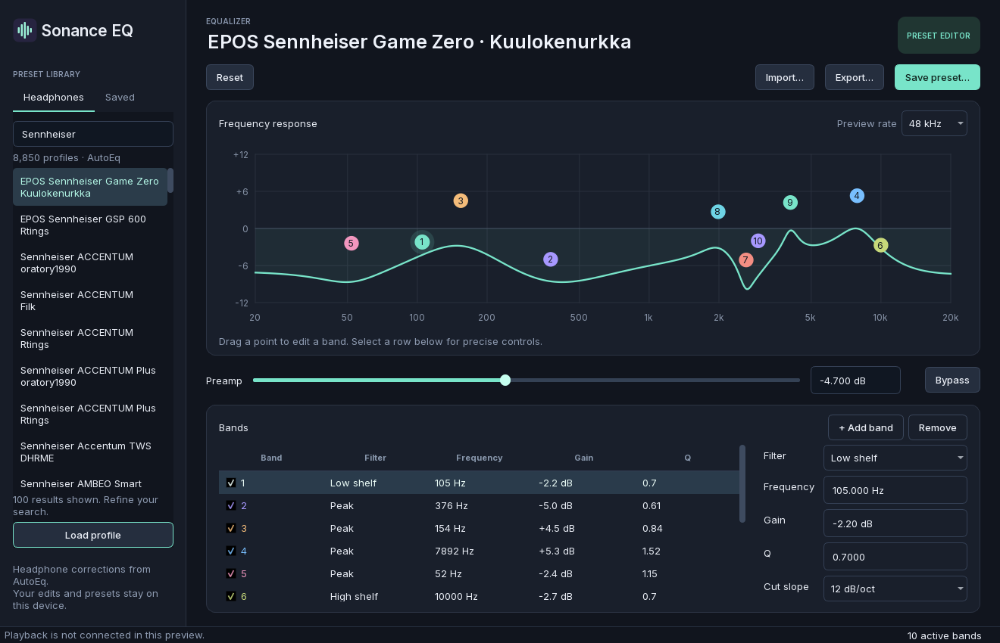
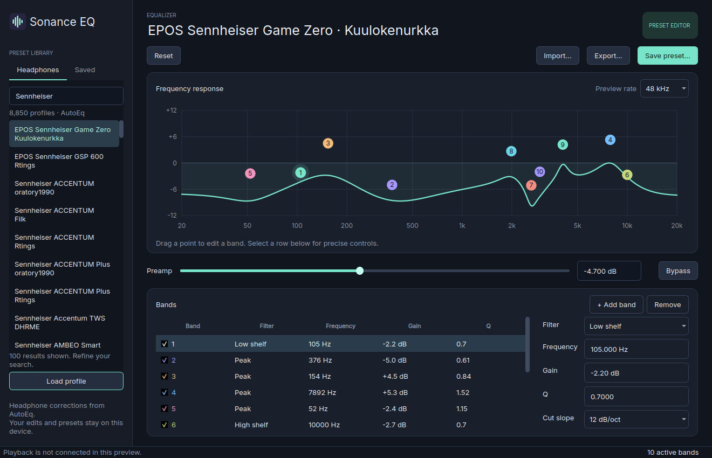

# Orion desktop UI verification — November 7, 2026

The Windows and Linux core EQ desktop editors are built and tested. Both preview
ZIPs contain working band editing, native response calculation, headphone search,
preamp/bypass preview, preset import/export, saved copies and session restore.
**System playback is not connected. These are unsigned owner developer previews.**

## Verified source and execution

- UI source revision: `c856f9aa7623fced3282e3fa00cf7db85871208c`.
- Registered source SHA-256: `539dab747809e4410278e1372fbada26c4dad9e90b0dac2253c34b17b6188bf5`.
- Git archive SHA-256: `c4007cf1c8dd7531a8853ce9a9f1c1028cd9e78fdb592b801b860f5a02e94a72`.
- Windows x64: installed Visual Studio Build Tools, MSVC 19.43.34810.0, Python 3.11.9.
- Linux x64: Orion Ubuntu WSL2, GCC 13.3.0, glibc 2.39, Python 3.12.3.
- PySide6 Essentials/shiboken6 6.10.2, PyInstaller 6.22.3, unmodified Inter 4.1.

The authenticated `software.sonance_core` lane used a task-scoped copy of the
Orion controller, registered source/runtime hashes, serialized jobs and one
compiler process. No hosted build, metered API or GitHub Actions runner was used.

| Profile | Orion job | UI tests | DSP assertions | Preset tests |
|---|---|---:|---:|---:|
| windows-ui | wrk_6fdf981cd4804b1198055b63f3693778 | 9 | 5278 | 5 |
| linux-ui | wrk_e87a38f262664b189d4613c6d514f66f | 9 | 5278 | 5 |
| windows-asan | wrk_622a673768454d58a4049fde2350584b | — | 5278 | 5 |
| linux-sanitizers | wrk_dccb6d897a5840f89387d97d8d0010d6 | — | 5278 | 5 |

Both UI jobs also passed the native C ABI/layout/boundary test and evaluated 1,584
coefficient cases. Windows and Linux coefficients differed by at most
`2.220446049250313e-16` (tolerance `1e-12`).
Windows AddressSanitizer and Linux address/undefined/leak checks passed on revision
`128fc09`; their native core, bridge, CMake and bridge-test files are byte-identical
to the final UI snapshot. The machine-readable receipt records those file hashes.

## UI and packaged startup checks

Nine real Qt integration tests per OS cover mouse/key editing, graph dragging,
preamp/bypass, the actual 8,850-row headphone database, import/export, saved copies,
session restoration, invalid input preservation, real font glyphs and a compact
1100×740 layout. Tests use the native library, real SQLite data and temporary
files. No mock providers or mock file dialogs were added.

The frozen executables launched with development core/database/PYTHONPATH
overrides removed. Both found their bundled native ABI, 8,850 headphone profiles,
512 response points and Inter font. Windows used the normal `windows` Qt window
backend in Orion's task session; its fitted 1100×749 layout passed the graph/text
separation check. Linux used `offscreen` in WSL2. This does not qualify a physical
Linux X11/Wayland desktop or any system audio endpoint.

Visual review found and corrected missing Windows offscreen fonts and a compact
native-window graph overlap. Upstream wheel notice omissions and Windows notice
path separators were also corrected. Initial failed job receipts remain in the
local artifact set; the final jobs above passed without removing old tests.

[Native Windows frozen startup](../images/desktop-windows-ui-frozen-2026-11-07.png)
and [compact layout](../images/desktop-compact-2026-11-07.png) are retained too.

## Preview artifacts

| Archive | Bytes | SHA-256 |
|---|---:|---|
| SonanceEQ-Windows-UI-Preview.zip | 42026653 | `d35f496795ee1c1ea9f791ccdb5b3c3f3c5d85e6cc7effe8ce045b6b4275724a` |
| SonanceEQ-Linux-UI-Preview.zip | 90529572 | `307fd260d632d70c4d2ac78c3e1995985f72be279bc2403d66b5c941a64e7819` |

Local artifact root:
`/Users/isaiahdupree/Documents/Software/artifacts/sonance-eq-ui-20261107/`.
Each archive is in its `windows-ui/` or `linux-ui/` subdirectory, alongside logs,
verified artifact manifests, screenshots and frozen startup receipts. Orion
retains the same files under each job's `out/` directory in
`E:/orion-jobs/sonance-ui-128fc09/workers/jobs/`.

Extract the complete folder and open `SonanceEQ.exe` on Windows or `SonanceEQ` on
Linux. Python is bundled. Do not separate the executable from `_internal/`.
Bundle inspection verified PE/ELF signatures, Linux executable permission,
native/data/font resources and the notice files referenced by `packages.json`.
Exact upstream notice/font hashes are retained; copying incomplete wheel
metadata alone is not treated as a complete license set.

## Cleanup and remaining release work

All seven Orion runtime/contract checks passed. The private controller and port
18810 forward were stopped after the queue emptied. Shared controller port 8788
remained healthy at its original PID 23172. No recurring automation was started.

Repository Actions permissions remain `enabled:false`. One historical September
21 run is still reported as queued; both cancellation endpoints returned HTTP
409 stating it has not been queued. Actions were not enabled, dispatched, rerun
or used to resolve that inconsistent record.

Remaining work is actual system audio integration, smooth live changes, output
and device recovery, physical playback/latency qualification, install/upgrade/
uninstall, signing, commercial entitlements and Store certification. External
release also requires complete corresponding-source and third-party distribution
compliance. No Store submission or new paid service was started.

See the [editor guide](../DESKTOP-EDITOR.md), [platform plan](../WINDOWS-LINUX.md)
and [machine-readable receipt](ORION-DESKTOP-UI-2026-11-07.json).
